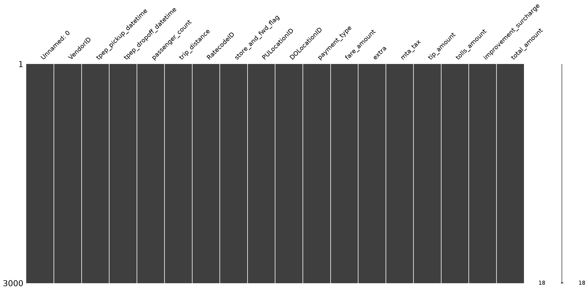
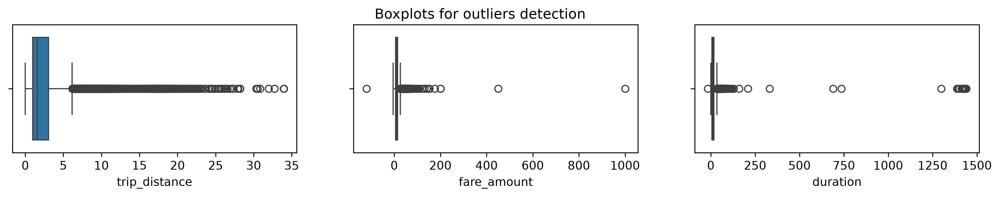
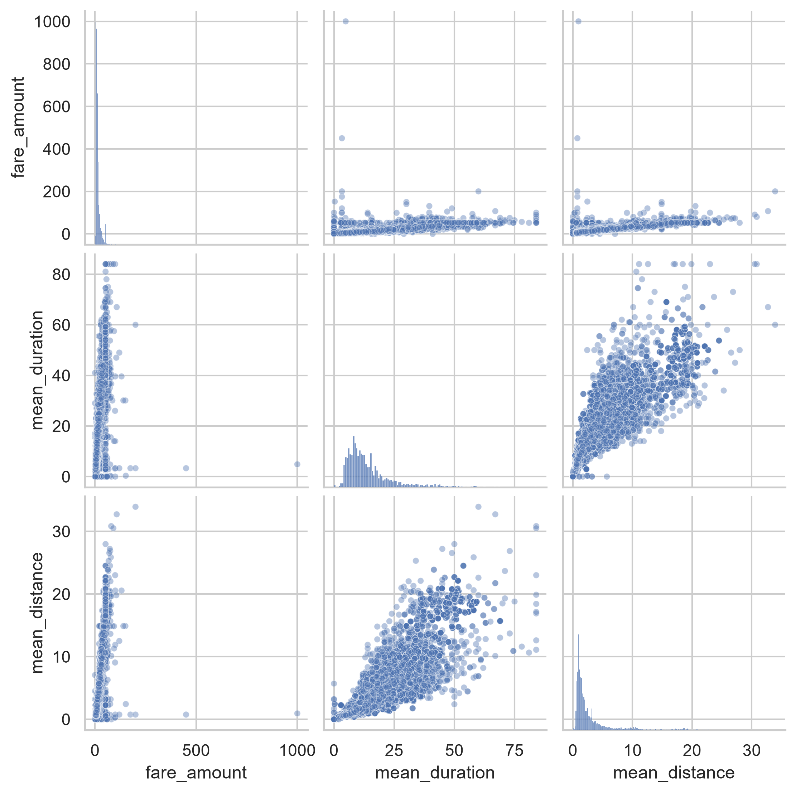
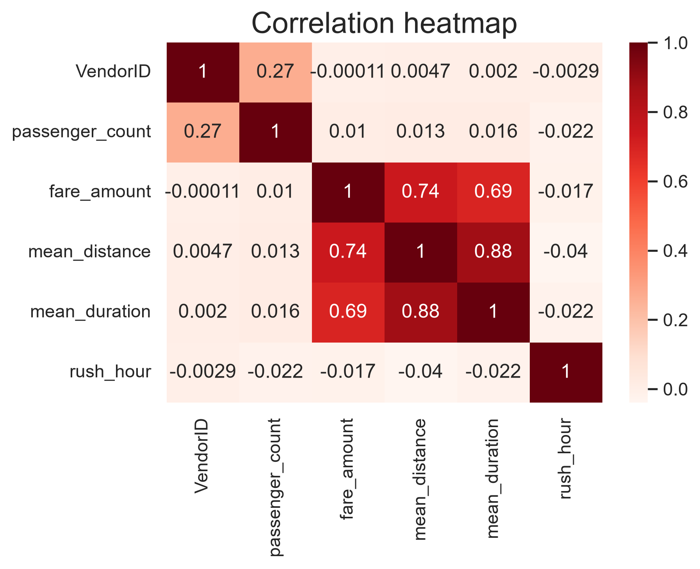
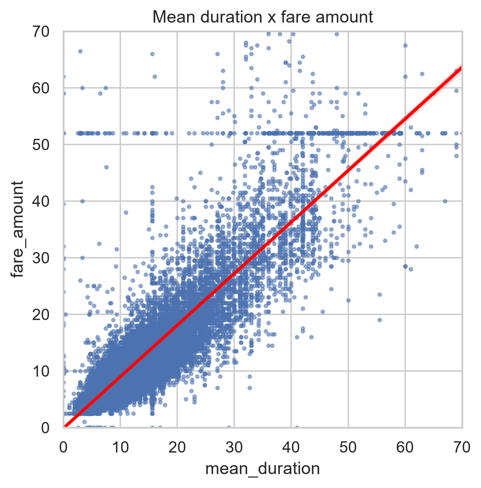
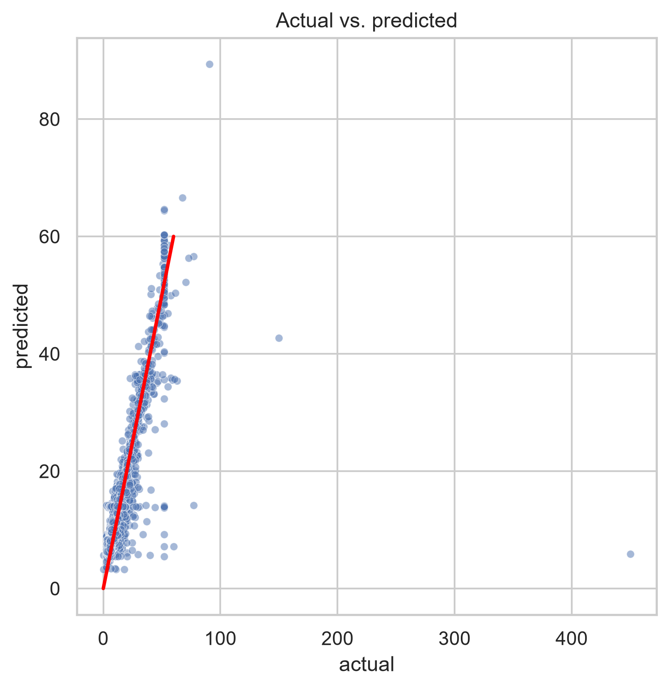
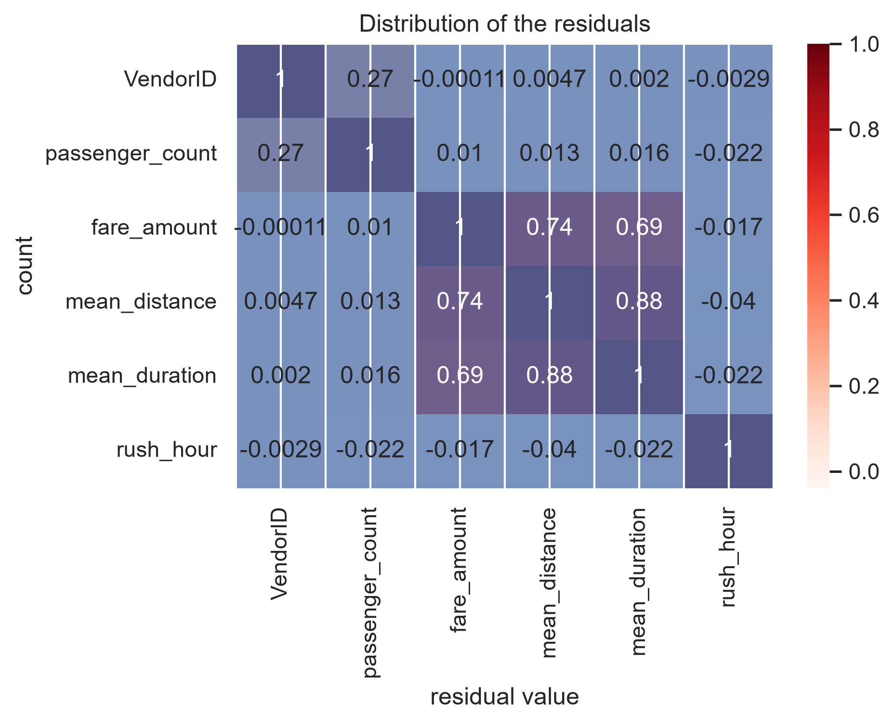
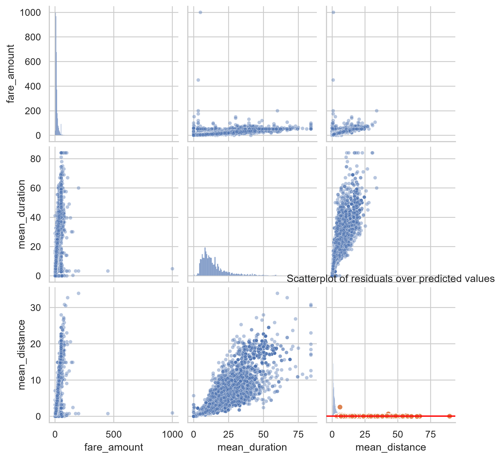

# automatidata-multiple-linear-regression
Predictive linear regression model for NYC Yellow Taxi trip fares using Python, Scikit-learn, and Seaborn.
# 🚕 Automatidata: NYC Taxi Fare Predictive Modeling

A comprehensive end-to-end data science and machine learning project focused on predicting New York City yellow taxi trip fares (`fare_amount`) using Linear Regression, exploratory data analysis (EDA), and advanced feature engineering.

---

## 📌 Table of Contents
- [Project Overview](#-project-overview)
- [Dataset & Tools](#-dataset--tools)
- [Exploratory Data Analysis & Cleaning](#-exploratory-data-analysis--cleaning)
- [Feature Engineering & Modeling](#-feature-engineering--modeling)
- [Model Evaluation & Residual Analysis](#-model-evaluation--residual-analysis)
- [Key Business Insights](#-key-business-insights)
- [Repository Structure](#-repository-structure)

---

## 📖 Project Overview
The main objective of this project is to build a multiple linear regression model that accurately estimates total taxi fares for NYC yellow cab trips based on journey characteristics. By identifying key price drivers, this model assists in providing transparent fare estimates to passengers and optimizing operational fleet management.

---

## 🛠 Dataset & Tools
* **Dataset:** 20,000+ NYC Yellow Taxi trip records.
* **Languages & Libraries:** Python (Pandas, NumPy, Matplotlib, Seaborn, SciPy, Statsmodels, Scikit-learn, Missingno).
* **Workflow:** Data Cleaning $\rightarrow$ EDA $\rightarrow$ Feature Engineering $\rightarrow$ Preprocessing (`StandardScaler`, `OneHotEncoder`) $\rightarrow$ Model Training $\rightarrow$ Residual Diagnostics.

---

## 🧹 Exploratory Data Analysis & Cleaning

### 1. Data Integrity & Missing Values
Data quality checks were conducted using the `missingno` library to verify completeness across features.

<p align="center">
  
</p>

### 2. Outlier Detection
Outliers in numerical variables such as `trip_distance`, `fare_amount`, and `duration` were analyzed using interquartile range (IQR) boxplots to prevent skewed estimates during regression training.

<p align="center">
  
</p>

### 3. Feature Correlations
We examined relationships between average trip distance, average trip duration, and total fare. Linear correlations were confirmed across key numerical metrics.

<p align="center">
  
</p>

<p align="center">
  
</p>

---

## ⚙️ Feature Engineering & Modeling

Key feature enhancements were implemented to improve model predictive capabilities:
* **`mean_distance` & `mean_duration`:** Calculated average distance and duration grouped by pickup and dropoff locations to represent route baselines.
* **`rush_hour`:** Categorical indicator for trips occurring during weekday peak traffic hours.
* **`RatecodeID`:** Encoded trip types (e.g., flat rates to JFK Airport).

Linear relationships were verified, such as `mean_duration` vs `fare_amount`:

<p align="center">
  
</p>

---

## 📊 Model Evaluation & Residual Analysis

The final Linear Regression model achieved high predictive precision. Evaluation was conducted through residual analysis to confirm standard OLS assumptions (linearity, normality, homoscedasticity).

### Actual vs. Predicted Fares
The model closely aligns predicted fare values with actual recorded trip costs along the diagonal target line.

<p align="center">
  
</p>

### Residual Distribution & Homoscedasticity
Residuals are centered near zero with a normal distribution. Scatterplots over predicted values show consistent variance without heteroscedastic patterns.

<p align="center">
  
  
</p>

---

## 💡 Key Business Insights
1. **Primary Price Drivers:** Average trip distance ($r = 0.91$) and average duration ($r = 0.86$) are the strongest predictors of total fare amounts.
2. **Airport Flat Rates:** Flat-rate trips (e.g., JFK Airport transfers via `RatecodeID = 2`) display distinct fare patterns that require specialized categorical encoding.
3. **Operational Recommendation:** Integrate the model into rider-facing applications for upfront fare quotes and leverage zone-level duration metrics for dynamic fleet dispatching during peak demand periods.

---

## 📁 Repository Structure
```bash
.
├── images/                        # Exported high-resolution visual assets (DPI 300)
│   ├── missingno_matrix.png
│   ├── boxplots_outliers.png
│   ├── pairplot_matrix.png
│   ├── correlation_heatmap.png
│   ├── mean_duration_vs_fare.png
│   ├── actual_vs_predicted.png
│   ├── residuals_distribution.png
│   └── residuals_vs_predicted.png
├── Executive_Summary.pdf           # Executive summary deck export
├── automatidata_linear_model.py    # Main Python script containing data processing & ML pipeline
└── README.md                       # Repository overview and documentation
